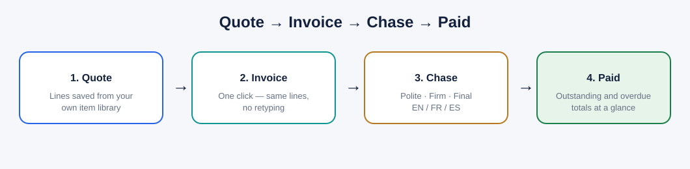
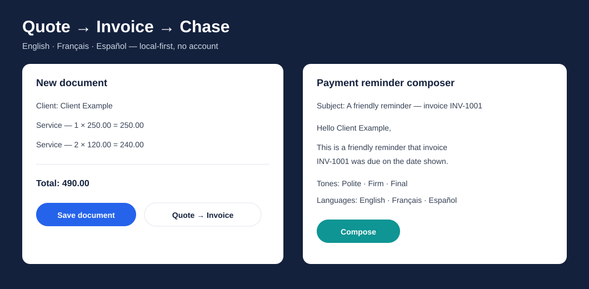

# Quote → Invoice → Chase

**A trilingual quote, invoice, and payment-reminder kit for service businesses — local-first, no account, no subscription.**

**Live tool:** https://oviainc.github.io/quote-invoice-chase/

## What we built

We built this kit for the moment every service business knows well: the work is done, the quote was approved, and then the invoice sits unpaid while someone finds the time — and the words — to follow up.

With this tool, we:

- Create a **quote** from saved clients and a saved item/service library, in minutes
- Give every quote a **valid-until date**: it prints on the quote under its own label in the document language, the documents list counts down the days it still holds, and a quote past its date shows as expired — so the price never sits open forever, and the last follow-up has a real date to point at
- **Follow up on quotes that go quiet** — most quotes are never refused, they are simply never answered. The composer carries a three-step quote rhythm written in English, French, and Spanish: a check-in a few days after sending (did it arrive, is anything unclear), a follow-up about a week later that adds something useful (including splitting the work into a smaller first step), and a closing note near the valid-until date that takes the quote off the list while leaving the door open. Every follow-up is logged on the quote, the documents list suggests the next step for every open quote — from the day it was sent, the follow-ups already logged, and its valid-until date — with that step pre-selected in the composer, and the dashboard counts the open quotes still waiting on an answer
- **Record the outcome on every quote** — accepted, declined, or expired — so the record shows what actually happened to each quote, not only the ones that became invoices. An accepted quote's next step reads ready to invoice; a closed quote stops asking for follow-ups
- Turn an approved quote into an **invoice in one click** — same lines, no retyping
- Set the due date in one tap with **payment terms** — due on receipt, Net 7, Net 14, or Net 30 — so every invoice leaves with an explicit, shorter-by-default deadline instead of an open-ended one
- Track every document as draft, sent, paid, or **automatically overdue** by its due date, with **due-in / days-overdue timing** on every invoice
- See **outstanding, overdue, and paid totals** at a glance
- See **who owes what, by client**: every client with money still open, grouped in one view — how many invoices are open, the balance still due, and the oldest due date — so the weekly chase starts from a clear per-client picture, not from memory
- See **how old the open money is**: an aging view groups every open balance by how long it has waited — not yet due, then 1–30, 31–60, 61–90, and over 90 days past due, per currency, with the invoice count in each bucket — so the weekly review reads oldest first, because the longer a balance waits, the harder it is to collect
- See the **collection rate at a glance**: the share of invoiced money that has actually arrived — payments received divided by everything invoiced, part-payments counted as they land — so the weekly review watches one number rise, and a rate that stalls while the aging buckets grow is the signal to chase harder, oldest first
- See **how long payment actually takes**: the average days to pay — days sales outstanding worked out from the invoices on record, the average time between an invoice being created and being paid in full, counting only invoices with a payment date on record so the number never guesses — so the weekly review watches the wait itself, not only whether the money eventually arrived. A wait that climbs while the collection rate stalls is the signal to shorten terms or chase sooner
- Compose a **payment reminder** in four steps — a heads-up before the due date, then polite, firm, and final — ready to copy and send
- Keep a **chase history on every invoice**: each reminder we compose is logged with its date and tone, so we always know what was sent and when
- **Record part-payments as they arrive**: each payment is logged with its date and amount on the invoice, the **balance due** drops at once, and the dashboard, the documents list, and every reminder then ask only for what is still owed — never for money already received. An invoice paid in full by its payments closes itself
- See the **suggested next step on every unpaid invoice** — heads-up, polite, firm, or final — worked out from its due date and the reminders already logged, with that step pre-selected in the composer, so what to send next is decided before the awkward moment arrives
- **Send one statement per client, not one reminder per invoice**: tick the statement box and we compose a single message listing every unpaid invoice for that client — number, due date, and balance due for each, with one total — in the client's document language (English, French, or Spanish). The statement is logged on every invoice it covers, so the chase history stays complete
- **Send the reminder where the client actually reads it** — one click opens the composed reminder in email (addressed to the saved client email when we have it) or in WhatsApp, ready to send; copy stays available for any other channel
- **The way to pay travels with the ask**: when payment details are saved, every reminder and every statement carries them at the end of the message, in the document language — so the client never has to ask how to pay, and a ready-to-pay client is never slowed down by a missing detail
- **State the late-payment terms where the client reads them**: when late-payment terms are saved for the business — a late fee, a recovery fee, whatever terms we set ourselves — they print on every document and travel with every reminder and statement, under a label in the document language (English, French, or Spanish). The terms are stated on the document itself, not remembered from an earlier conversation
- **Track a promise to pay, not just hear one**: when a client gives a date, record it on the invoice. The documents list shows the promised date, the suggested next step waits while that date is still ahead, and a promised date that passes unpaid brings the suggestion straight back to chasing — a promise becomes part of the record, not a conversation half-remembered
- **Agree a payment plan, then track it**: when a client cannot pay in full, offer a plan from the composer — a plan offer written in English, French, and Spanish that proposes splitting the balance into smaller payments and asks the client how many payments and dates would work, inventing no terms. Record the agreed plan on the invoice — how many payments, from which date, spaced a month apart — and the documents list shows it: how many payments, the amount of each, and the next instalment date. The suggested next step waits while the plan is on track, and the day an instalment is missed the suggestion returns to chasing — a plan is tracked, not just offered
- Print or save any document as a clean PDF from the browser
- Export and import a **JSON backup** of everything

## Who we built it for

Freelancers, trades, consultants, studios, and small service teams who bill clients directly — especially teams who work with clients in more than one language and are tired of rewriting the same quote, invoice, and awkward follow-up from scratch.

## Trilingual, properly

The interface switches between **English, Français, and Español**. More importantly, each document carries its own language: a client who receives French documents gets a French invoice and French reminders, even if we work in English day to day. The reminder templates are written in each language — heads-up, polite, firm, and final — and so are the three quote follow-ups — check-in, follow-up, and closing note — and the payment-plan offer — not passed through word-for-word machine translation.

## How the moat works

- **Your data accumulates here.** Every client we save, every item in the library, and every document in the history makes the next quote faster. That growing, structured history is a switching cost no blank template can match.
- **Language depth is the niche.** Global billing tools often add languages as a thin translation layer. We wrote the full workflow — interface, documents, and all four reminder steps — in English, French, and Spanish from the start.
- **The payment history compounds too.** Every part-payment logged builds the per-invoice record of what arrived and when, so the balance a client is reminded about is always the true balance — that accuracy is part of the history a blank template cannot offer.
- **The chase history compounds.** Every logged reminder builds a per-client record of what was sent and when. That history is what turns chasing from memory and guesswork into a rhythm — and it lives only in this kit. It also drives the suggested next step on every invoice, so the history does not just record the rhythm, it sets it.
- **Per-client clarity compounds too.** Balances, part-payments, and due dates roll up per client automatically, so the longer the kit is used, the clearer the picture of who owes what — knowledge a blank template starts from zero on.
- **Aging is part of the picture too.** The same due dates and balances roll up into aging buckets automatically, so how long the open money has been waiting is always visible at a glance — the weekly review starts from the oldest money, not from whichever invoice happens to be on top.
- **The collection rate is part of the picture too.** The same payments and totals already recorded roll up into one rate automatically, so whether the chasing is actually working is visible at a glance — a number that only exists because the payments were logged here, invoice by invoice.
- **Days to pay is part of the picture too.** The same creation and payment dates roll up into the average wait automatically, so how fast clients actually pay — not just how much — is visible at a glance. That number only exists because each payment was logged here with its date, and it completes the weekly review: overdue balance, aging mix, collection rate, and now the wait itself.
- **Terms are part of the record too.** The late-payment terms saved for the business are snapshotted onto every document, so the terms that applied when an invoice was issued stay with that invoice — and they travel with the chase, in the document's own language.
- **Promises are part of the record too.** A promised payment date sits on the invoice alongside its payments and reminders, holds the next step while it is still ahead, and flags itself the day it is missed — the kind of per-client payment behaviour a blank template never learns.
- **Plans are part of the record too.** An agreed payment plan sits on the invoice alongside its payments, promises, and reminders, with each instalment date on record — the per-client payment behaviour the kit learns now includes whether plans are kept, which a blank template never learns.
- **The quote record compounds too.** Every quote follow-up logged and every outcome recorded builds the front of the same record: which quotes were answered, how long an answer took, and what became of the ones that went quiet. That history drives the suggested next step on every open quote, so the rhythm that gets quotes answered is set by the record, not by memory — and it starts accumulating from the first quote, before any invoice exists.
- **It embeds in the weekly workflow.** Quoting, invoicing, and chasing are not one-off tasks; they are the weekly rhythm of getting paid. A tool that sits in that rhythm stays.
- **Clients see it.** Every quote, invoice, and reminder a client receives came from here — counterparties discover the kit through the documents themselves.

## Local-first and private

There is no account and no server. Everything is stored only in the browser's local storage on the device where it is used. Nothing is sent anywhere. Export a backup regularly, and import it on another device whenever needed.

Multi-currency (USD, EUR, GBP, MXN, CHF, AUD) with tax rates we set ourselves per document — we define our own rates, so the kit works wherever we work.

## Use it

Open the live tool, add the business details once, save the first client and item, and send the first quote. No sign-up step stands in the way.

## Licence

MIT — see `LICENSE`.
