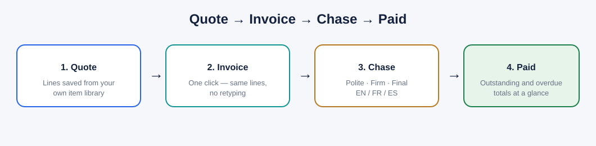
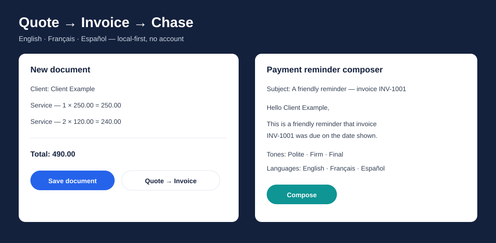

# Quote → Invoice → Chase

**A trilingual quote, invoice, and payment-reminder kit for service businesses — local-first, no account, no subscription.**

**Live tool:** https://oviainc.github.io/quote-invoice-chase/

## What we built

We built this kit for the moment every service business knows well: the work is done, the quote was approved, and then the invoice sits unpaid while someone finds the time — and the words — to follow up.

With this tool, we:

- Create a **quote** from saved clients and a saved item/service library, in minutes
- Turn an approved quote into an **invoice in one click** — same lines, no retyping
- Track every document as draft, sent, paid, or **automatically overdue** by its due date, with **due-in / days-overdue timing** on every invoice
- See **outstanding, overdue, and paid totals** at a glance
- Compose a **payment reminder** in four steps — a heads-up before the due date, then polite, firm, and final — ready to copy and send
- Keep a **chase history on every invoice**: each reminder we compose is logged with its date and tone, so we always know what was sent and when
- See the **suggested next step on every unpaid invoice** — heads-up, polite, firm, or final — worked out from its due date and the reminders already logged, with that step pre-selected in the composer, so what to send next is decided before the awkward moment arrives
- Print or save any document as a clean PDF from the browser
- Export and import a **JSON backup** of everything

## Who we built it for

Freelancers, trades, consultants, studios, and small service teams who bill clients directly — especially teams who work with clients in more than one language and are tired of rewriting the same quote, invoice, and awkward follow-up from scratch.

## Trilingual, properly

The interface switches between **English, Français, and Español**. More importantly, each document carries its own language: a client who receives French documents gets a French invoice and French reminders, even if we work in English day to day. The reminder templates are written in each language — heads-up, polite, firm, and final — not passed through word-for-word machine translation.

## How the moat works

- **Your data accumulates here.** Every client we save, every item in the library, and every document in the history makes the next quote faster. That growing, structured history is a switching cost no blank template can match.
- **Language depth is the niche.** Global billing tools often add languages as a thin translation layer. We wrote the full workflow — interface, documents, and all four reminder steps — in English, French, and Spanish from the start.
- **The chase history compounds.** Every logged reminder builds a per-client record of what was sent and when. That history is what turns chasing from memory and guesswork into a rhythm — and it lives only in this kit. It also drives the suggested next step on every invoice, so the history does not just record the rhythm, it sets it.
- **It embeds in the weekly workflow.** Quoting, invoicing, and chasing are not one-off tasks; they are the weekly rhythm of getting paid. A tool that sits in that rhythm stays.
- **Clients see it.** Every quote, invoice, and reminder a client receives came from here — counterparties discover the kit through the documents themselves.

## Local-first and private

There is no account and no server. Everything is stored only in the browser's local storage on the device where it is used. Nothing is sent anywhere. Export a backup regularly, and import it on another device whenever needed.

Multi-currency (USD, EUR, GBP, MXN, CHF, AUD) with tax rates we set ourselves per document — we define our own rates, so the kit works wherever we work.

## Use it

Open the live tool, add the business details once, save the first client and item, and send the first quote. No sign-up step stands in the way.

## Licence

MIT — see `LICENSE`.
